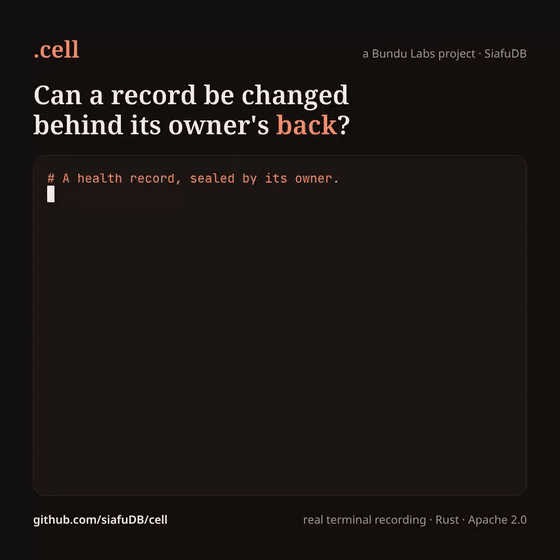

<div align="center">

# .cell

**One record. Its facts, its words, its owner's signature, all in one file that cannot lie.**

[](https://github.com/siafuDB/cell/actions/workflows/ci.yml)
[](https://www.apache.org/licenses/LICENSE-2.0)


<a href="#see-it-in-30-seconds"></a>

**Version:** 0.1.1 (prototype, not on crates.io) | **Spec:** [SPEC.md](SPEC.md) · [standards.bundu.org/cell](https://standards.bundu.org/cell/) | **Home:** [SiafuDB](https://siafudb.org) | **Licence:** Apache 2.0

</div>

---

## The problem

Every app you have built has this bug somewhere. A record has a field that says
`"dose": "200mg"` and a note underneath that says "take 100mg twice a day". Someone edited one
and not the other. Now the record disagrees with itself, and nothing noticed.

Multiply that by every health record, receipt, contract and contact a person owns, copied
between a phone, a cloud and three databases that each reshape it. That is how personal data
rots.

## The idea

A **cell** is one record that one entity owns: a person, a household or a business. Inside it:

- **Facts**, each stated exactly once, in typed [schema.org](https://schema.org) fields.
- **Words**, in Markdown, that can only mention a fact by reference: `{{dateCreated}}`, never
  the date typed out again.
- **A hash** over both, in [RFC 8785](https://www.rfc-editor.org/rfc/rfc8785) canonical form.
  Edit a fact or a word without resealing, and the cell is invalid.
- **A signature** by the owner's key, and a **version chain**, where each version names the hash
  of the one before. History can grow. It cannot be quietly rewritten.

It is plain JSON-LD, so any system that reads JSON can read it. It is the same record in a
`.cell` file or a database row, and the hash proves it. It needs no server to read, check or
verify, so it works offline, on a phone, at the edge, in a browser.

Nothing in it is invented. JSON-LD, schema.org, CommonMark, RFC 8785, Ed25519 and W3C Data
Integrity already exist. The .cell is the envelope that holds them together so they cannot
drift apart.

## See it in 30 seconds

Watch it first: a sealed health record, one word changed behind its owner's back, and the
change caught. [Terminal recording (MP4, 30 s)](docs/media/tamper-demo-terminal.mp4) ·
[Animated explainer (MP4, 28 s)](docs/media/tamper-demo-explainer.mp4). Then run it yourself:

```sh
cargo install --git https://github.com/siafuDB/cell
```

Write a draft cell, `draft.cell`:

```json
{
  "@context": "https://schema.org",
  "@type": "MedicalCondition",
  "@id": "urn:cell:01JD3Q7Z8K2V5M",
  "name": "Asthma",
  "possibleTreatment": { "@type": "Drug", "name": "Salbutamol inhaler" },
  "dateCreated": "2024-03-11",
  "text": "Diagnosed on {{dateCreated}}. Carry the {{possibleTreatment.name}} when walking far.",
  "cell:version": 1
}
```

Make a key, seal the cell, and read it back:

```console
$ cell keygen --out alice
wrote alice.key (secret: keep it private) and alice.pub (public: share it)

$ cell seal draft.cell --key alice.key > asthma.cell
$ cell check asthma.cell && echo valid
valid

$ cell verify asthma.cell --pub alice.pub
proof: valid

$ cell render asthma.cell
Diagnosed on 2024-03-11. Carry the Salbutamol inhaler when walking far.
```

Now try to change the medicine behind the owner's back:

```console
$ sed -i 's/Salbutamol/Budesonide/' asthma.cell
$ cell check asthma.cell
error: cell:hash does not match the content
```

Caught. The fact and the sentence that uses it moved together, and the seal knew they moved.

## Use it from Rust

The `cell` command is a thin layer over the `siafudb_cell` library. This is
[`examples/quickstart.rs`](examples/quickstart.rs); `cargo run --example quickstart` runs it.

```rust
use serde_json::json;
use siafudb_cell::{keys, render, seal, validate, verify_proof};

fn main() {
    // One record, facts and words together.
    let draft = json!({
        "@context": "https://schema.org",
        "@type": "MedicalCondition",
        "@id": "urn:cell:01JD3Q7Z8K2V5M",
        "name": "Asthma",
        "possibleTreatment": { "@type": "Drug", "name": "Salbutamol inhaler" },
        "dateCreated": "2024-03-11",
        "text": "Diagnosed on {{dateCreated}}. Carry the {{possibleTreatment.name}} when walking far.",
        "cell:version": 1
    });

    // Hash it and sign it with the owner's key.
    let (secret, public) = keys().expect("system randomness");
    let mut cell = seal(&draft, &secret);
    println!("hash:     {}", cell["cell:hash"]);
    println!("valid:    {}", validate(&cell, None).errors.is_empty());
    println!("signed:   {}", verify_proof(&cell, &public));
    println!("reads:    {}", render(&cell, "en").unwrap());

    // Change one fact, and every sentence that uses it changes with it...
    cell["possibleTreatment"]["name"] = json!("Budesonide inhaler");
    println!("reads:    {}", render(&cell, "en").unwrap());

    // ...but the hash no longer matches, so the edit is caught until it is resealed.
    let report = validate(&cell, None);
    println!("tampered: {:?}", report.errors);
}
```

```text
hash:     "sha256-fdVwdiu56bBj9twYtlZzlSQSfu9bo3shfm3ZGhiq1ZA"
valid:    true
signed:   true
reads:    Diagnosed on 2024-03-11. Carry the Salbutamol inhaler when walking far.
reads:    Diagnosed on 2024-03-11. Carry the Budesonide inhaler when walking far.
tampered: ["cell:hash does not match the content"]
```

Until the crate is published, depend on it from git:

```toml
[dependencies]
siafudb-cell = { git = "https://github.com/siafuDB/cell" }
```

| Function       | What it does                                                                  |
| -------------- | ----------------------------------------------------------------------------- |
| `parse`        | Reads JSON as I-JSON (RFC 7493): a duplicate member is refused, not ignored   |
| `canonicalize` | The RFC 8785 (JCS) canonical form, checked against the RFC's own test vectors |
| `hash`         | `sha256-` plus the base64url SHA-256 of the canonical content                 |
| `render`       | Fills every `{{field}}` from the facts, per language                          |
| `validate`     | Every rule in the spec, and the version chain when given the previous version |
| `seal`         | Sets `cell:hash` and signs it with Ed25519                                    |
| `verify_proof` | Checks the signature against the owner's public key                           |
| `keys`         | A fresh Ed25519 key pair from the system's randomness                         |

## A real profile, in three cells

[`examples/profile/`](examples/profile) is a whole person's profile as a platform would hold it, built from
our founder's real record: three cells that point at each other by `@id`.

| Cell | Type | What it holds |
| --- | --- | --- |
| [`person.cell`](examples/profile/person.cell) | `Person` | Name, handle, nationality, language, five interests, and a founder role in two entities |
| [`family.cell`](examples/profile/family.cell) | `Organization`, `bundu:Family` | The household entity and its members |
| [`nyuchi-africa.cell`](examples/profile/nyuchi-africa.cell) | `Organization` | The company, where it was founded, and its founder |

The public facts are real. Anything personal is a sample: the email (`person@example.org`), the phone
number, the family's name and every `@id`. Each cell passes `cell check` with no warnings, and the
tests check that every link resolves to a cell in the set.

```console
$ cell render examples/profile/person.cell
Bryan Fawcett, known as bryanfawcett, is the Founder of Nyuchi Africa and belongs to The Sample family. Interests: Technology, AI & Machine Learning, Fintech & Mobile Money, Wildlife & Conservation and African Identity.
```

## The CLI

`cell help` prints:

```text
cell 0.1.1: validate, render, hash, seal and verify .cell records
Implements the .cell spec 0.1.0 draft, proposed.

Usage: cell COMMAND [ARGS]
       cell help COMMAND

Commands:
  check      Validate a cell, and its version chain with --previous
  render     Print a cell's text with every {{field}} filled in
  hash       Print the content hash and say whether it matches cell:hash
  canonical  Print the cell in RFC 8785 (JCS) canonical form
  keygen     Make an Ed25519 key pair: NAME.key (secret) and NAME.pub
  seal       Set cell:hash and sign it; prints the sealed cell
  verify     Check a cell's proof against a public key
  help       Show this list, or the details of one command
  version    Print the crate version and the spec version it implements

FILE may be - to read the cell from standard input.

Exit codes:
  0  ok
  1  the cell is invalid, or a check, a read or a write failed
  2  usage error: an unknown command or flag, or a missing argument

Examples:
  cell check asthma.cell
  cell check v2.cell --previous v1.cell
  cell render asthma.cell --lang sn
  cell keygen --out alice
  cell seal draft.cell --key alice.key > asthma.cell
  cell verify asthma.cell --pub alice.pub
  cat asthma.cell | cell hash -

Run `cell help COMMAND` for the details of one command.
```

It reads from standard input with `-` and uses clean exit codes, so it drops into a shell
pipeline, a pre-commit hook or a CI step. Its argument handling is the standard library only.

## Built to be broken

The test suite does not just check the happy path. It attacks the format:

- **13 stress cases** ([`tests/stress.rs`](tests/stress.rs)): duplicate keys, Unicode normal
  forms, integers beyond 2^53, forked version chains, references to missing fields, a value that
  looks like a reference, deleted history, and more.
  Pass 1 of the stress test found eight decisions the draft spec still has to make; they are
  written up in [SPEC.md](SPEC.md#stress-test-pass-1-2026-11-17).
- **RFC 8785 vectors** ([`tests/jcs.rs`](tests/jcs.rs)): the canonical form matches the RFC's
  own examples, number formatting included.
- **The CLI** ([`tests/cli.rs`](tests/cli.rs)): every command, every exit code, standard input.
- **A Postgres round trip** (the 13th stress case): store a cell in a `jsonb` column, read it
  back, and the hash holds even though Postgres rewrote the bytes. Run it with `CELL_PG="psql -h HOST -U postgres" cargo test -- --ignored`.

```sh
cargo test           # 44 tests; the Postgres round trip runs with --ignored
cargo clippy --all-targets -- -D warnings
cargo fmt --check
```

## Where cells live: SiafuDB

A cell is the record. [SiafuDB](https://siafudb.org), the embedded graph database for the
device, the edge and the browser, is where it lives and how it moves:

| .cell                       | SiafuDB                                                    |
| --------------------------- | ---------------------------------------------------------- |
| A cell, keyed by `@id`      | A node keyed by `@id`, holding the cell unchanged          |
| Links between cells         | Edges, from the cell's JSON-LD references                  |
| Offline first, on the phone | SiafuDB on the device is the cell's first home             |
| Device to cloud to pod      | The SiafuDB Graph Sync Protocol carries cells between them |
| The version chain           | Sync carries each version unchanged, by its hash           |

A change to the .cell spec is checked against SiafuDB, and the other way round.

## Help decide what a cell is

The spec is a **0.1.0 draft**. That means the hard questions are still open, and this is the
moment your opinion changes the format instead of arriving after it is fixed:

- A scan or a photo: one big cell, or a cell that points at a separate file?
- Encryption at rest: JWE around the whole cell, or only around the sensitive fields?
- Two phones edit the same cell offline. How should the version chain merge?
- References as JSON Pointer (`{{/possibleTreatment/name}}`) instead of dotted paths?

Pick one, open an issue, and argue for an answer. Bring a test case if you can: a cell that
breaks the current draft is the most useful contribution there is. See
[CONTRIBUTING.md](CONTRIBUTING.md).

## Use it with an AI agent

This repository is also a Claude Code plugin marketplace. The `cell` plugin carries one skill
for writing, validating, rendering, sealing and verifying cells. It is Markdown only: no scripts
and no hooks.

```text
/plugin marketplace add siafuDB/cell
/plugin install cell@siafudb-cell
```

The skill is [`plugin/skills/cell/SKILL.md`](plugin/skills/cell/SKILL.md). The tests check that
every command `cell help` lists appears in the skill and that the plugin version is the crate
version, so the skill cannot fall behind the code.

## Status

Honest about where this is:

- The spec is **proposed, not adopted**. Nothing is final until the owner approves its scope
  ([bundu-standards#107](https://github.com/bundu-labs/bundu-standards/issues/107)).
- The crate is a **prototype validator** for stress-testing the draft, not the reference
  implementation. It is not on crates.io yet.
- The `proof` follows the shape of a W3C `eddsa-jcs-2022` proof, not yet its exact algorithm.
- The `cell:` names and the JSON-LD context URL are draft; the context is not published yet.

## Contributing

[CONTRIBUTING.md](CONTRIBUTING.md) has the setup and the rules (Rust only, tests with every
change, signed-off commits). Report security issues privately: see [SECURITY.md](SECURITY.md).
Everyone here follows the [Code of Conduct](CODE_OF_CONDUCT.md). AI agents start at
[AGENTS.md](AGENTS.md).

## Licence

The code is Apache 2.0 ([LICENSE](LICENSE)). The spec text is CC BY 4.0; any schema and JSON-LD
context is CC0 1.0.

The .cell is a project of **Bundu Labs**, the research arm of the
[Bundu Foundation](https://bundu.org), which stewards the spec. It lives in the SiafuDB
organisation because a cell is what SiafuDB stores.
